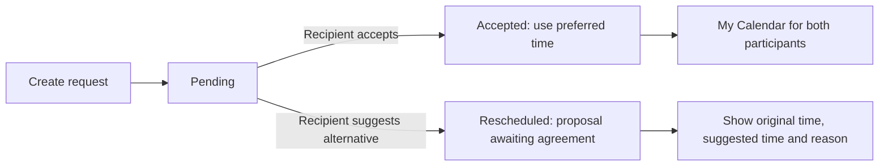

# Appointments: reviewed design and minimal UAT changes

Date: 16 October 2026. Status: user approved this design and the explicit Test/UAT additions. Implementation is authorized; Production deployment and the pending site restart are not included.

## Scope and existing application

Enhance the existing `src/pages/Appointments.tsx` prototype, enable Activity → Appointments and its existing Home shortcut, and implement the four supplied screenshots. Replace sample/local-only data with the existing Dataverse table. Reuse the current React/TypeScript SPA, app shell, role detection, CSRF utility, ContactLookup, calendar components, colors and scoped styles. Do not introduce frontend dependencies or change existing Events, Meeting Reports, Contacts, Meeting Invites, Press Coverage or Join Event behavior.

My Calendar currently loads registered Events and accepted **Meeting Invites**, using independent data requests. Those invites use `mss_meetinginvites` / participant records, not `mss_appointment`. Add Appointments as an independent third source so an Appointments failure does not remove existing Events or Meeting Invites. Namespace appointment calendar IDs to prevent collisions. Do not create Outlook/Google events or copy rows to a separate calendar table.

The earlier Press Coverage UAT deployment succeeded. Its cache restart and authenticated hosted checks remain pending and are separate from approval of this design. This request does not authorize a restart or a Production deployment.

## Verified Appointment metadata

Read-only inspection used the supported Dataverse SDK and Web API in the previously selected Test/UAT environment `16838866-275a-e2e7-838f-57313f30a416`, `https://org97063a46.crm.dynamics.com`.

| Property | Verified value |
|---|---|
| Table | `mss_appointment` |
| Entity set | `mss_appointments` |
| Primary ID | `mss_appointmentid` |
| Primary name | `mss_appointmenttitle`, maximum 850 characters |
| Recipient | `mss_contact`, target Contact, navigation `mss_Contact` |
| Recipient relationship | `mss_appointment_Contact_contact` |
| Preferred/suggested dates | `mss_preferreddate`, `mss_suggesteddate`; UserLocal DateAndTime |
| Agenda/reason | `mss_purposeagenda`, `mss_reschedulingreason`; maximum 100 characters |
| Meeting link | `mss_meetinglink`; URL format, maximum **100 characters** |
| Optimistic concurrency | Enabled |
| Requester Contact | **Absent** |

Title, recipient, format, preferred date, status and agenda have Dataverse ApplicationRequired metadata. The prompt explicitly makes Agenda optional, so the portal design keeps Agenda optional; ApplicationRequired is a model-driven form requirement rather than a SystemRequired database constraint. Required format follows the metadata. Do not relax the schema silently. Validate against any actual server rules during UAT.

Verified statuses:

| Value | Actual label | Portal use proposed |
|---|---|---|
| 866530000 | Pending | New request, awaiting recipient response |
| 866530001 | Accepted | Confirmed at the preferred date/time |
| 866530002 | Rejected | Read-only status display; no new rejection workflow requested |
| 866530003 | Rescheduled | Proposed alternative pending agreement; never treated as Accepted |
| 866530004 | Cancelled | Read-only status display; no cancellation workflow requested |

Use actual labels rather than inventing a Requested option. The supplied Budget Review row exists in UAT: its status 866530004 means **Cancelled**, and format 2 means **Phone Call**. Its recipient is null; do not infer participants from its System User owner/creator.

Verified formats:

| Value | Actual label | Acceptance behavior |
|---|---|---|
| 1 | Microsoft Teams | Require a valid HTTPS meeting URL; no invented URL or new host restriction |
| 2 | Phone Call | Accept without requesting a meeting URL; do not expose private phone details |
| 3 | In Person | Accept without a meeting URL |

No Appointment workflow definitions or matching/bound Custom APIs were found in the queries performed. There is no requester-confirmation path in the current SPA. This establishes a workflow gap; it does not prove that no external automation exists elsewhere in the tenant.

## Recommended approach and alternatives

**Recommended:** a dedicated Appointments ServerLogic endpoint, one immutable Requester Contact lookup, and a small Dataverse server action/plugin for validated atomic mutations. Keep direct portal Web API CRUD for this table disabled. Extend My Calendar by fetching only authorized Accepted appointments. This meets participant privacy, trusted requester identity, recipient-only responses and stale-update protection while keeping the current SPA and table.

**Alternative:** keep the schema unchanged and provide only a restricted legacy recipient view. It cannot securely provide outgoing lists, trustworthy requester names, creator stamping or both-participant calendar visibility. It does not meet the full request and is not recommended.

A new external backend would add hosting, authentication and deployment work without improving this design's fit with the existing Power Pages/Dataverse architecture, so it is not proposed.

## Explicit UAT additions requested for approval

1. Add one optional Contact lookup **Requester**, proposed schema `mss_Requester` / logical `mss_requester`, on `mss_appointment`. Set it only from trusted portal identity during creation; keep requester and recipient immutable through portal operations. Confirm the actual generated navigation/relationship after creation. Do not backfill imported records by guessing from `createdby` or `ownerid`.
2. Increase the existing Meeting Link column maximum from **100 to 2,000 characters** so real online meeting links can be stored. This changes no existing values and adds no column. Keeping 100 would reject many ordinary meeting URLs.
3. Register a small solution-contained Dataverse Custom API/plugin for appointment request creation and recipient state changes. It receives the authenticated actor only from the protected server endpoint, validates participants/fields/state, and uses a row-version-checked SDK update. Add least-privilege endpoint/table configuration for Appointments only; preserve existing permissions. No new business table, separate date/time field, file storage or external service is required.

The need for the action is specific: the current documented ServerLogic `UpdateRecord(entitySetName,id,payload)` and `InvokeCustomApi(method,url,payload)` signatures do not expose an If-Match/header argument. A read-then-unconditional-update in JavaScript cannot guarantee the requested concurrency-safe transitions. Do not invent a fourth argument or claim a browser version check is atomic. Dataverse optimistic concurrency is available and will be applied inside the registered action.

Sources inspected: [Power Pages Server objects](https://learn.microsoft.com/power-pages/configure/server-objects), [Dataverse conditional operations](https://learn.microsoft.com/power-apps/developer/data-platform/webapi/perform-conditional-operations-using-web-api), [SDK optimistic concurrency](https://learn.microsoft.com/power-apps/developer/data-platform/optimistic-concurrency).

## Workflow and rescheduling boundary

The recipient alone can accept or propose rescheduling. The requester cannot act for the recipient. This design gives Administrators read visibility, without an implicit right to accept on somebody else's behalf.

Rescheduling writes the reason, suggested datetime and actual Rescheduled status to the same row. It preserves the original preferred datetime. Because no confirmed requester-approval workflow exists, this version displays proposals to both parties, keeps them out of My Calendar, and offers no additional confirmation transition. The screen will explain that the proposal is awaiting agreement. A future confirmation workflow requires a separately agreed rule for recording the confirmed time; an unconfirmed suggested datetime never becomes the meeting time automatically.

The awaiting-response badge counts only incoming Pending records. Accepted, Rejected, Rescheduled and Cancelled do not count. All statuses remain readable. Imported rows with an unknown requester cannot appear in a user's outgoing list and are never attributed speculatively; a known recipient may see their own incoming legacy row with an honest unknown-requester label, and administrators can review legacy records.

## Identity, Contact selection and security

All appointment requests carry server-derived portal Contact identity. Browsers cannot submit requester IDs, arbitrary status values, owner fields or arbitrary Dataverse queries. Each request operation has a fixed allowlist. The server action independently checks actor/recipient/requester and expected status/version before writes. Direct browser table writes remain disabled.

Read permissions are the union of Requester Contact scope and Recipient Contact scope; administrators may read globally. Do not grant global ordinary-user read/write. Query only participant-authorized rows, including for counts and calendar details; client-side filtering is supplementary. Anonymous users cannot read, search eligible portal Contacts or mutate appointments.

Contact selection reuses ContactLookup but searches through the protected Appointments endpoint, returns only Contact ID/full name, debounces, escapes input, limits results and excludes the current Contact. The trusted eligibility check requires an active Contact with portal login enabled and a local portal username or external identity; do not offer the entire unrelated CRM directory. UAT metadata exposes the identity fields and `adx_contact_externalidentity` relationship. Identity/account information remains server-side and is never returned. Existing profile approval/role gates continue to govern module access; pending-user appointment access must be a narrow participant route exception, without unlocking other application routes.

Creation and recipient actions are available to signed-in users authorized for this module; no new blanket access to unrelated pages is introduced. Enforce the same eligibility check when saving, because the selected Contact may have become unavailable since searching. Reject self-appointments in the UI and server endpoint to preserve the requested two-party workflow.

## Date/time policy

Use **America/New_York**, consistent with existing Home meeting display and the supplied ET screenshots. Dataverse stores UserLocal appointment instants as UTC. Combine Preferred Date/Time and Suggested Date/Time using Eastern timezone rules; split the stored instant for editing/display in Eastern Time. Never use the browser timezone or the Press Coverage publication-date timezone (Amman) for appointments.

Explicitly show Eastern Time beside inputs. Reject nonexistent spring-forward local times. For ambiguous fall-back times, require choosing the first or second occurrence, with the UTC offset shown, rather than guessing. Store only the resulting UTC instant in each existing datetime field. The backend verifies that the submitted instant round-trips to the submitted Eastern date/time/offset and complies with supported Dataverse limits.

Do not add conflict detection, unavailable slots, scheduling duration or external calendar sync. No business rule in the prompt requires future-only scheduling; do not invent one. Accepted appointments use the preferred instant, never an unconfirmed suggestion.

## UI, data flow and error handling

The header/subtitle/button and the two sections follow the screenshots. Request form fields are title full width; Contact/format; preferred date/time; Agenda full width. Keep lists visible beneath the form. Incoming cards use requester initials, name, status and ET date/time; only one accept/reschedule panel can expand at once. Outgoing cards show recipient, date/time, agenda, status, proposal details and a safe Join meeting link only for Accepted online meetings with a valid URL.

Use bounded server pagination, loading/empty/error/retry states for each list, exact awaiting counts and abort/stale-response protection. Cancel resets drafts and restores focus. Confirm discarding edited forms; lock form switching, links and duplicate submissions while saving. Preserve failed input. When a create result is uncertain, require checking the refreshed list rather than creating another record. A concurrency conflict refreshes the row and asks the user to review its current state; it never overwrites a newer response silently.

My Calendar adds accepted appointments independently of the existing two sources and retains partial success when a source fails. Display appointment calendar day/time in Eastern Time, including near midnight and DST changes; preserve existing Event and Meeting Invite display behavior. Both authorized participants see the same accepted appointment without duplication. Join meeting opens a validated HTTPS URL in a new tab with safe rel attributes; existing Event actions remain labeled Join Event.

## Implementation boundaries and acceptance

New feature code belongs under `src/features/appointments/`, plus scoped CSS, backend action source/registration definitions and Appointments-only ServerLogic metadata. Replace the current Appointments page prototype and tests. Target existing-file changes to App/Nav/Home shortcut, the narrow role route exception, MyCalendar and related tests. Reuse shared utilities without broad refactoring. Preserve all existing uncommitted work, including Press Coverage and Join Event corrections.

Tests must cover separate users A/B/C, secure create stamping, recipient-only actions, requester impersonation, administrator read behavior, forged fields, record-level list/count/calendar privacy, exact status/format values, ambiguous create results, version conflicts and invalid/stale transitions. Also cover both required online-link and no-link Phone/In Person acceptance; original versus proposed times; cancellation/dirty/duplicate-submit behavior; DST gaps/folds; repeatable responsive/accessibility checks; full regression and production build.

Hosted security acceptance needs real signed-in UAT sessions for both participants, another ordinary user and an administrator. Local mocked responses cannot prove it. UAT schema/action additions are subject to the approval requested above. Site deployment is reviewed separately after implementation; no Production write or deployment is authorized here.

## Review checklist

- [x] Read the supplied prompt and all four UI references.
- [x] Review existing prototype, routing, identity, Contact lookup, My Calendar, Meeting Invite and Event loaders.
- [x] Verify table/entity set, fields, lookup navigation, constraints, actual choices, dates and concurrency support.
- [x] Confirm sample record in UAT and inspect table workflow/Custom API definitions.
- [x] Identify requester, URL-length, concurrency and rescheduling-confirmation gaps explicitly.
- [x] Review design for scope, internal consistency, privacy and preservation of existing logic.
- [x] User approves this design and the enumerated UAT additions.
- [x] Write the implementation plan, implement and verify locally; approved UAT schema/action applied. Site deployment and hosted multi-user verification remain separate.
